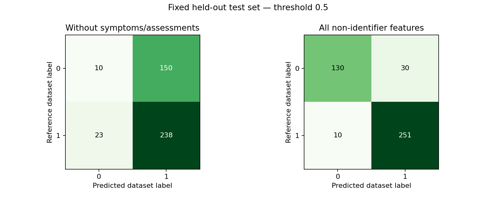

# Parkinson's Classification Lab

An educational machine-learning project comparing how feature selection changes classification performance on a **synthetic Parkinson's dataset**. This project does not diagnose people or establish early detection.

## Question
How does performance change when symptom and clinical-assessment columns are excluded, compared with using all non-identifier features?

## Why this question matters
A high score is not enough. Features closely related to the label can make a classification task easier without demonstrating useful prediction at an earlier point in time. This project uses two predeclared feature scenarios, a simple baseline, training-only cross-validation, and a fixed holdout to make that distinction visible.

## Data and attribution
- Publisher: **Rabie El Kharoua**, *Parkinson's Disease Dataset Analysis* (Kaggle).
- Source: https://www.kaggle.com/datasets/rabieelkharoua/parkinsons-disease-dataset-analysis
- License listed by publisher: **CC BY 4.0**, https://creativecommons.org/licenses/by/4.0/
- Publisher explicitly describes the data as **synthetic and generated for educational purposes**.
- Input: 2,105 rows, 35 columns, no missing cells; target `Diagnosis` (0/1).
- The supplied CSV was verified as byte-for-byte identical to the CSV in the publisher's downloadable archive on 2026-10-19. Its SHA-256 is recorded in `reports/metrics.json`.
- The CSV is not committed. Follow `data/README.md` to obtain it.

## Method
1. Reject missing/duplicate patient identifiers, repeated feature rows, invalid target values, and infinite feature values.
2. Exclude `PatientID`, `DoctorInCharge` and `Diagnosis` from model inputs.
3. Split 80% training / 20% holdout with stratification and seed 42: 1,684 / 421 records.
4. Fit imputation, scaling and categorical encoding inside each training fold.
5. Compare a constant-prior baseline, logistic regression and a random forest using five-fold cross-validation on training data only.
6. Select the non-baseline model with the highest mean CV average precision for each scenario.
7. Evaluate the selected model and baseline on the fixed holdout with threshold 0.5. No tuning is based on holdout results.

Categorical codes (`Gender`, `Ethnicity`, `EducationLevel`) are one-hot encoded. Other binary columns remain 0/1. Assessments and symptoms excluded in the restricted scenario are listed in `src/train.py`.

## Results from the supplied CSV

| Feature scenario | Selected model | Holdout average precision | Balanced accuracy | Recall | Specificity |
|---|---|---:|---:|---:|---:|
| Without symptom / assessment columns | Logistic regression | 0.624 | 0.487 | 0.912 | 0.062 |
| All non-identifier features | Random forest | 0.964 | 0.887 | 0.962 | 0.812 |

The holdout positive-label fraction is **0.620**, which is the constant-score baseline average precision. The restricted model offers very little AP improvement over that baseline and has extremely low specificity at 0.5. Its high recall alone would be misleading. The full model performs better on this synthetic task; that is not clinical validation.



See `reports/summary.md`, `metrics.json` and `cross_validation.csv` for exact results and CV variability. CV standard deviations are not confidence intervals.

## Run locally
Python **3.11+** recommended.

```bash
python -m venv .venv
# macOS / Linux:
source .venv/bin/activate
# Windows PowerShell instead:
# .venv\Scripts\Activate.ps1
python -m pip install -r requirements.txt
# Place the downloaded CSV in data/ first.
python -m src.train
python -m unittest discover -s tests -v
python -m streamlit run app.py
```

The training command generates reports and locally saved pipelines. The Streamlit app reads the saved reports; it displays scenario metrics, CV comparisons, confusion matrices and anonymous held-out examples. It has **no patient-input form**.

## Files
- `src/train.py`: data checks, pipelines, training-only model selection, holdout evaluation, plots.
- `app.py`: read-only Streamlit experiment explorer.
- `tests/test_training.py`: metric arithmetic, excluded inputs and training-only scaling checks.
- `reports/`: generated metrics, fold results, test-label predictions, plots and written summary.
- `LEARN_AR.md`: Arabic walkthrough and interview questions.
- `notebooks/walkthrough.ipynb`: guided notebook that runs the same training module.

## Validation status
Training completed on the supplied CSV using scikit-learn 1.8.0, pandas 2.2.3 and NumPy 2.3.5. Three targeted unit checks passed. Plot outputs were rendered and reviewed. The Streamlit source was syntax-checked, but the app was not launched because Streamlit is unavailable in the execution environment. App runtime and mobile layout are not yet verified.

## Limits and ownership
This is synthetic data, with no demonstrated external validity. Feature/label generation and measurement timing are insufficiently documented to establish causal relationships, diagnosis, clinical risk, early detection or treatment decisions. Classifier scores are not calibrated individual clinical risks. Feature ablation shows sensitivity to feature choice, not proof of real-world leakage.

Code and documentation were prepared with AI assistance as a learning project. Understand and adapt the implementation before presenting it in an interview. Data attribution remains with its publisher; this project does not claim to have collected patient data.
